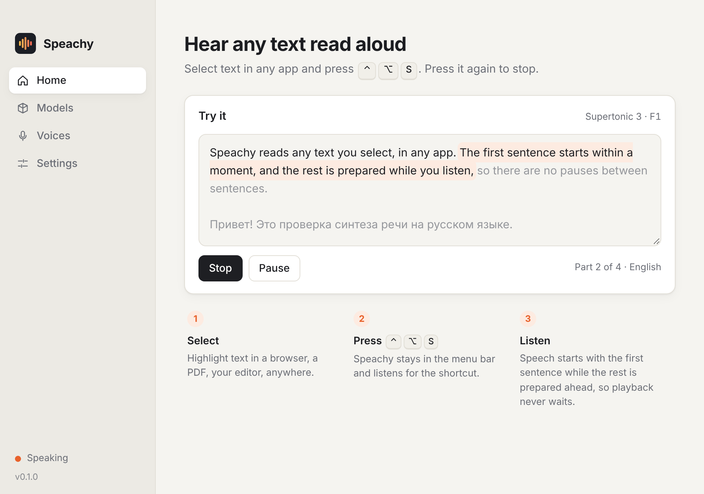
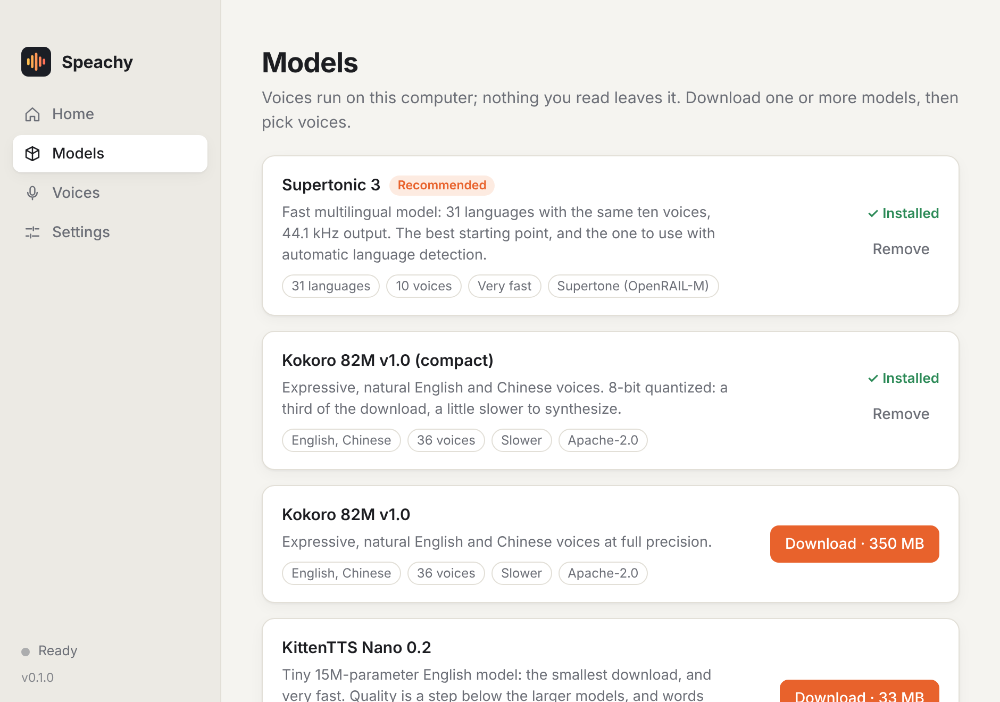
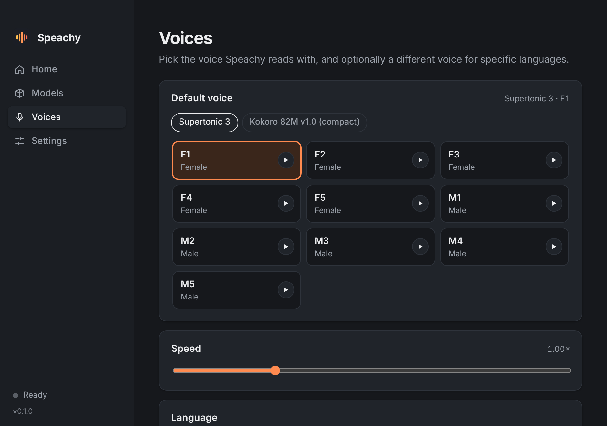

# Speachy

Select text in any app, press a shortcut, and hear it read aloud — by a
text-to-speech model that runs entirely on your computer.

Speachy is the mirror image of dictation tools such as Wispr Flow or
[Handy](https://github.com/cjpais/Handy): they turn speech into text, Speachy
turns text into speech. It lives in the menu bar, and a small pill at the
bottom of the screen shows what is being read.



## What it does

- **Speak the selection.** Press <kbd>⌃</kbd><kbd>⌥</kbd><kbd>S</kbd> with
  text selected anywhere. Press it again to stop, or select something else and
  press it to switch. <kbd>⌃</kbd><kbd>⌥</kbd><kbd>P</kbd> pauses and resumes,
  <kbd>⌃</kbd><kbd>⌥</kbd><kbd>X</kbd> stops. All three can be changed.
- **Starts quickly, never waits.** Text is split into chunks. The first one is
  short, so speech starts as soon as it is synthesized; the following ones are
  synthesized ahead of playback and queued back to back, so there are no gaps
  between them. See [How the pipeline works](#how-the-pipeline-works).
- **Choose and download models.** The Models tab lists the supported models
  with their size and languages; downloads resume if interrupted.
- **Choose voices.** Pick a default voice and, if you like, a different voice
  for specific languages. Every voice has a preview button.
- **Detects the language.** Each part of the text is read in its own language
  with a voice that can speak it. Mixed-language text works.
- **Private.** Nothing you read leaves the machine. The network is used only
  to download models.

| Models | Voices |
| --- | --- |
|  |  |

## Models

| Model | Download | Languages | Voices | Notes |
| --- | --- | --- | --- | --- |
| **Supertonic 3** (recommended) | 129 MB | 31 | 10 | Fast, 44.1 kHz. The one to use with language detection. |
| Kokoro 82M v1.0 | 350 MB | English (US, British), Chinese | 36 | Expressive voices; needs a faster machine to stay ahead of playback. |
| Kokoro 82M v1.0 (compact) | 132 MB | same | 36 | 8-bit quantized: smaller download, somewhat slower. |
| KittenTTS Nano 0.2 | 33 MB | English | 8 | Tiny and fast; skips words missing from its dictionary. |
| KittenTTS Mini 0.1 | 163 MB | English | 8 | Larger KittenTTS model, same limitation. |

All of them run through [sherpa-onnx](https://github.com/k2-fsa/sherpa-onnx)
on the CPU. Model weights are downloaded from the sherpa-onnx `tts-models`
release into the app's data directory and carry their own licences
(Supertonic: OpenRAIL-M; Kokoro and KittenTTS: Apache-2.0).

## Install

Download the disk image for your Mac from the
[Releases](https://github.com/AaLexUser/speachy/releases) page
(`macos-arm64` for Apple Silicon, `macos-x64` for Intel), open it and drag
Speachy to Applications. The app is not notarized by Apple, so the first
time macOS will refuse to open it: allow it under **System Settings →
Privacy & Security → Open Anyway**, or run
`xattr -dr com.apple.quarantine /Applications/Speachy.app` once.

To build it yourself instead:

```sh
# Prerequisites: Rust (https://rustup.rs) and the Xcode command line tools.
cargo install tauri-cli --version "^2" --locked

cargo tauri dev      # run from source
cargo tauri build    # produce target/release/bundle/macos/Speachy.app and a .dmg
```

The first build downloads the prebuilt sherpa-onnx library for your platform.
There is no JavaScript toolchain: the interface in `ui/` is plain HTML, CSS
and JavaScript.

First run:

1. Open the **Models** tab and download a model (Supertonic 3 is a good
   start).
2. On macOS, grant **Accessibility** access when asked (System Settings →
   Privacy & Security → Accessibility). Speachy needs it to read the text
   selected in other apps.
3. Select some text anywhere and press <kbd>⌃</kbd><kbd>⌥</kbd><kbd>S</kbd>.

Closing the window keeps Speachy running in the menu bar; quit from the menu
bar icon. *Launch at login* and *Start in the menu bar* are in Settings.

> An app you build yourself is ad-hoc signed, and macOS ties the Accessibility
> permission to the signature. After rebuilding you may have to remove and
> re-add Speachy in the Accessibility list.

## How the pipeline works

```
selection ──► clean up ──► chunks ──► language + voice per chunk
                                              │
                    ┌─────────────────────────┘
                    ▼
        synthesis worker ──► gapless audio queue ──► speakers
        (runs ahead of         (chunk, pause, chunk, …)
         playback)
```

1. **Reading the selection** (`src-tauri/src/selection.rs`). On macOS the
   Accessibility API is asked for the focused element's selected text. Apps
   that do not expose it (many browsers and Electron apps) get a simulated
   <kbd>⌘</kbd><kbd>C</kbd> instead, after which the previous clipboard
   contents are put back.
2. **Chunking** (`crates/speachy-core/src/text.rs`). Markdown markup, URLs and
   hard line wraps are cleaned up, then the text is cut at sentence
   boundaries (and at clause boundaries inside very long sentences, never
   inside a word). The first chunk is at most ~110 characters. Each later
   chunk may be as long as everything before it combined, up to 280
   characters: as long as synthesis is at least twice as fast as playback, a
   chunk is always ready before it is needed.
3. **Language and voice** (`lang.rs`, `plan.rs`). The language of the whole
   text and of each chunk is detected from its script, common words and
   letter statistics (a change of script always starts a new chunk). Each chunk then gets a voice: your
   choice for that language, else the default voice if it speaks the
   language, else any installed model that does.
4. **Synthesis ahead of playback** (`pipeline.rs`). A worker synthesizes the
   chunks in order and keeps going until a configurable amount of audio
   (20 s by default) is waiting, then idles until playback catches up — so
   stopping early wastes little work. The model is loaded once and kept warm;
   by default it is preloaded at launch.
5. **Gapless playback** (`audio.rs`). Finished chunks are appended to one
   audio queue and play back to back. Silence at the edges of each chunk is
   trimmed and replaced by a deliberate pause that depends on the boundary
   (clause, sentence, paragraph), so the rhythm does not depend on where the
   text happened to be cut.

For English with Kokoro, words are converted to phonemes by
[misaki-rs](https://github.com/MicheleYin/misaki-rs), the Rust port of the
phonemizer Kokoro was trained with (`english.rs`); words it does not know are
sounded out by spelling rules rather than skipped.

## Engine and interface

The engine is a library with no user-interface dependencies; the desktop app
is a thin shell around it. Everything the app does is an engine command, and
the same commands are available from a terminal, which makes the engine easy
to script, debug and test without a window, a screen or a sound card.

```
crates/speachy-core/   The engine
  src/session.rs         the front door: commands in, events out
  src/catalog.rs         downloadable models and their voices
  src/models.rs          download (resumable), unpack, remove
  src/text.rs            cleaning and chunking
  src/lang.rs            language detection
  src/plan.rs            language and voice for each chunk
  src/engine.rs          sherpa-onnx synthesis, loaded-model cache
  src/english.rs         English phonemes for Kokoro
  src/pipeline.rs        synthesize-ahead pipeline, pause / stop
  src/audio.rs           gapless output queue
crates/speachy-cli/    Headless front end: subcommands and a JSON channel
src-tauri/             The desktop shell (Tauri 2): windows, menu-bar icon,
                       shortcuts, reading the selection
ui/                    Settings window and overlay pill (no build step)
```

```sh
cargo build --release -p speachy-cli      # target/release/speachy-cli

speachy-cli models                         # what can be installed, what is
speachy-cli install supertonic-3
speachy-cli plan "Hello. Привет, как дела?"   # chunks, language and voice of each
speachy-cli speak "Hello from Speachy."
speachy-cli speak --voice M2 --out hello.wav "Hello."
speachy-cli run '{"cmd":"snapshot"}'       # any engine command, as the app sends it
speachy-cli serve                          # JSON commands on stdin, replies and events on stdout
```

The CLI works on the same models and settings as the app unless `--home DIR`
is given. [AGENTS.md](AGENTS.md) lists the commands and events and describes
how to work on the engine headlessly.

## Development

```sh
cargo test --workspace                          # everything
cargo test -p speachy-core -p speachy-cli       # engine and CLI only; needs no GUI libraries
cargo clippy --workspace --all-targets -- -D warnings
```

The app also builds and runs on Linux (X11), where the shortcut reads the
primary selection. Building there needs the Tauri prerequisites plus
`libasound2-dev`, `libssl-dev` and `libxdo-dev`. Windows is untested.

### Updates

The app checks GitHub for a newer release shortly after launch and every
few hours (this can be turned off), and offers it under **Settings →
Updates**; nothing is installed without asking. `Speachy.app/Contents/MacOS/speachy
--update` does the same from a terminal. Only published, non-pre-release
versions are offered.

An update is an archive of the app signed with a key whose public half is
built into the app (`plugins.updater.pubkey` in `src-tauri/tauri.conf.json`).
The private half must be available to the Release workflow as the
repository secret `TAURI_SIGNING_PRIVATE_KEY`; without it releases are still
built, but installed apps cannot update to them. Keep that key safe: apps
only accept updates signed with it, so losing it means users have to
reinstall by hand.

Because the app is not signed with an Apple developer certificate, macOS
may ask for Accessibility access again after an update.

### Releasing

Set the version in `Cargo.toml` on `main`, then push a tag `vX.Y.Z` that matches it.
The **Release** workflow builds the app for Apple Silicon and Intel and the
CLI for macOS and Linux, checks each build (the CLI installs a model and
synthesizes a sentence; the app is launched), and publishes a GitHub release
with the files, their checksums, and the signed update archives and
`latest.json` that installed apps look for. Running the workflow by
hand from the Actions tab does the same but leaves the release as a draft;
the **Publish release** workflow then makes it public.

## Status and known limitations

This is a first version. The engine (chunking, language detection, downloads,
the pipeline, the command surface) is covered by tests, and the whole app has
been run end to end on Linux. The macOS-specific code — reading the selection through the
Accessibility API and the clipboard, the menu-bar icon, the overlay pill —
compiles for macOS but **has not yet been exercised on a Mac**; expect to
find rough edges there first.

- Kokoro needs a reasonably fast CPU. If synthesis is slower than playback
  you will hear pauses between chunks (the pill shows *Preparing…*).
- KittenTTS skips words that are not in its dictionary.
- Piper voices are not included: sherpa-onnx 2.0 no longer bundles the
  phonemizer they need.
- Language detection on a handful of words is unreliable by nature; short
  selections fall back to the language set under Voices → Language.
- The simulated <kbd>⌘</kbd><kbd>C</kbd> uses the physical key position of
  "C" on a QWERTY layout.
- The overlay pill appears on the main display.
